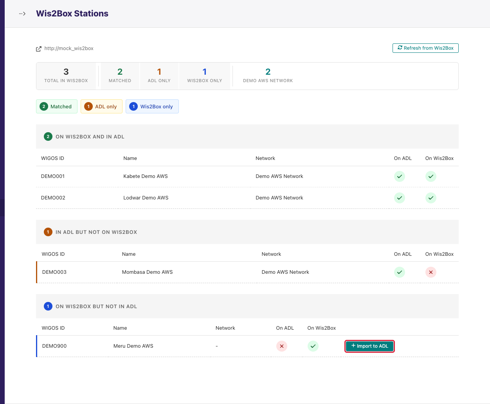

(wis2box-integration)=

# 📡 WIS2Box Integration

[wis2box](https://docs.wis2box.wis.wmo.int) is WMO's reference
implementation of a WIS2 node. ADL publishes observations to it by writing
CSV files into wis2box's MinIO storage, where wis2box's own pipeline turns
them into BUFR and publishes them. ADL and wis2box are separate systems,
usually on the same server; ADL talks to wis2box in two places, and this
page covers both.

```{mermaid}
flowchart LR
  subgraph ADL
    OBS[(Observation records)] --> DC[WIS2Box Upload\ndispatch channel]
    ST[Stations] <-. import / compare .-> WS[WIS2Box Stations page]
  end
  subgraph wis2box
    MINIO[(MinIO\nwis2box-incoming)] --> PIPE[csv2bufr → BUFR] --> PUB[WIS2 broker]
    OAPI[Station metadata\n/oapi/collections/stations]
  end
  DC -- "CSV per station\nper dispatch" --> MINIO
  WS -- "reads" --> OAPI
```

1. **Dispatching data** — a *WIS2Box Upload* dispatch channel uploads CSV
   files shaped for a wis2box csv2bufr template (AWS by default) into the
   `wis2box-incoming` bucket. This is the data path.
2. **Station metadata** — the *WIS2Box Stations* page under Settings reads
   the station list wis2box publishes and compares it with ADL's, so the
   two never disagree about which stations exist.

## Prerequisites

- A running wis2box with a **dataset** configured for surface observations
  using the csv2bufr template you will select on the channel (AWS unless you
  need another), with that template's csv2bufr mapping installed, and the
  stations registered in wis2box's station metadata. See the wis2box
  documentation for both.
- The wis2box **MinIO storage endpoint** (host and port, typically `:9000`)
  reachable from the ADL host, and the MinIO **username and password**
  (`WIS2BOX_STORAGE_USERNAME` / `WIS2BOX_STORAGE_PASSWORD` in wis2box's
  `wis2box.env`).
- The wis2box **dataset id** (the `topic_hierarchy`/dataset identifier used
  as the folder path under `wis2box-incoming`).
- Optionally the wis2box **public URL** for the stations page.
- If wis2box is on a different host and you want TLS between them, see
  [WIS2BOX with SSL on the ADL server](wis2box-adl-nginx-proxy-manager.md).

## Dispatching data to wis2box

### 1. Units

You do not choose the units a WIS2Box channel sends. Each column of the
csv2bufr template has a fixed unit (the AWS template uses **Kelvin** for
temperature, **Pascal** for pressure, **kg/m²** for precipitation, m/s for
wind speed and degrees for direction), and ADL converts your parameter's
values to it at dispatch time, so stored data stays in °C, hPa and mm. ADL
creates the template's unit under **Settings → Units** itself if it is
missing, so there is nothing to set up beforehand.

### 2. Create the channel

**Dispatch Channels → Add Dispatch Channel → WIS2BOX Upload**. The base
fields (name, connections, interval, timeout, batch size, aggregation) are
described in [Manage Dispatch Channels](user_guide/manage_dispatch_channels.md).
WIS2Box-specific fields:

| Field | Description |
|---|---|
| **Storage Endpoint** | MinIO host and port, without scheme: `wis2box-minio:9000` when both run on one Docker host and network, or `wis2box.example.org:9000`. |
| **Storage Username** / **Storage Password** | The MinIO credentials from `wis2box.env`. |
| **Use Secure Connection** | Tick when MinIO is served over HTTPS (behind a TLS proxy). Leave unticked for a plain `:9000` endpoint. |
| **Dataset ID** | The wis2box dataset identifier; files are uploaded to `wis2box-incoming/<dataset id>/`. |
| **csv2bufr Template** | The csv2bufr template the uploaded CSV follows. **AWS** is the default and the only template ADL ships; plugins can add more. The help text links to the template's documentation. |


```{important}
The template only works if the **matching csv2bufr mapping is installed in
wis2box** for the dataset. ADL writes the CSV in the template's layout;
wis2box converts it with its own mapping. If the template you select is not
the one the dataset uses, wis2box rejects the files.
```

### 3. Parameter mappings

Under **Parameter Mappings** the channel shows a **matching table**: one
row for every *observation column* of the selected template, grouped by
section (*Pressure*, *Temperature and humidity*, *Wind*, *Wind gusts*,
*Precipitation*, *Ground and snow*). You do not type column names, so they
cannot be misspelled. Each row has:

| Part | Description |
|---|---|
| **Column** | The template's column name, as csv2bufr reads it. |
| **Unit** | The unit the column takes. Read-only. |
| **ADL parameter** | A dropdown of the ADL parameters whose unit converts to the column's unit. A parameter already used in another row is greyed out and labelled *(used in `<column>`)*; a parameter can fill one column only. |
| **Aggregation** | How values are combined for the reporting period; see [Aggregation defaults](#aggregation-defaults). |

Pick the parameter for each column you want to send. **A row left at
*— not sent —* is not sent**: its column is empty in the CSV. To stop
sending a column you mapped before, set its row back to *— not sent —*;
that removes the mapping when you save. Saving the channel saves the
mappings in the same step.

Station and timestamp columns (WIGOS identifier parts, coordinates, heights,
station type, year to minute) are not in the table. They are filled from the
ADL station and the observation time, and a mapping can never overwrite them.
`thermometer_height` is sent from the station's thermometer height.

#### Units are locked and converted

Because the template fixes each column's unit, there is no *Channel Unit* to
choose on a WIS2Box channel. The *Unit* column shows what the template
expects, and ADL converts your parameter's values to it when it sends,
whatever unit the parameter is stored in:

- `1013.2 hPa` → `101320 Pa` in `station_pressure`
- `25 °C` → `298.15 K` in `air_temperature`
- `1.0 mm` → `1.0 kg/m²` in the precipitation columns (1 mm of rain over
  1 m² is 1 kg of water, so rainfall in mm is accepted without a custom
  unit)

The dropdown only offers parameters that convert, so you cannot map rainfall
to wind speed. Columns without a unit, such as `ground_state`, take a
dimensionless parameter. A saved mapping stores the template's unit as its
*Channel Unit*, but it is the template's unit that is sent. See the
[decision record](adr/0001-wis2box-csv2bufr-templates.md) for why.

(aggregation-defaults)=

#### Aggregation defaults

When the channel sends aggregated data, each row's **Aggregation** is
preset from the template: **Sum** for precipitation totals, **Maximum** for
wind gusts and `ground_state`, **Average** for the rest (including
`precipitation_intensity`, a rate). Change it in the row if your station
reports differently, for example a parameter that is already an hourly
total. A row whose choice differs from the template shows *Template default:
`<measure>`* under the control, so the change is visible.

If the channel does not send aggregated data, the Aggregation control is
shown disabled: it has no effect. Rainfall must use *Sum*; see
{ref}`Manage Dispatch Channels <dispatch-parameter-mappings>`.

The multi-hour columns (the 3, 6, 12 and 24 hour precipitation totals and
the 3 hour gust columns) carry a hint: *Needs a source parameter already
accumulated over N hours: hourly data cannot build this window.* ADL
aggregates by the hour only and does not build longer windows, so map these
columns to a parameter that already holds that window, or leave them *not
sent*. Mapping hourly data to a 24 hour column would publish a wrong total.

#### Switching the template

Changing **csv2bufr Template** rebuilds the table for the new template at
once, without saving. Mappings whose column exists in both templates are
kept in place. Mappings whose column the new template lacks are listed in a
warning above the table, *Switching the template will remove the mappings for
these columns, which it does not have*, before you save. Saving removes them,
and the kept mappings take the new template's unit. Switch back before
saving and the listed mappings return. With only the AWS template available
there is nothing to switch to.

#### Cleaning up after upgrading

Before the matching table, mappings were free text, so an existing channel
can hold mappings that fill no column: a misspelled name (`air_temp`), a
station column (`latitude`), a name the template does not have, or a second
mapping for a column that already has one. These were never sent. After
upgrading:

- Nothing is changed for you. **No migration touches mappings**, and the
  channel **keeps dispatching** as before until you edit it.
- The **Dispatch Channels** list shows an **N unmatched mappings** badge on
  each affected channel. It links to the channel, so you can find them all
  without opening each one.
- On the channel, an **Unrecognised mappings** block under the table lists
  each one with its stored column name, ADL parameter and why it is listed.
  Use **Reassign to** to move it to a free column its parameter fits, or tick
  **Remove**.
- The channel **cannot be saved until none remain**. That makes sure the
  clean-up happens the first time the channel is edited, rather than leaving
  a table that looks complete but sends less than it shows.

Channels whose *Channel Unit* was wrong (hPa on `station_pressure`) publish
in the template's unit as soon as ADL is upgraded, without editing. Search
the dispatch worker logs for `csv2bufr template expects` to see which
channels were affected.

### 4. Aggregation

wis2box expects one row per hour per station. Tick **Send Aggregated Data**
with period *hourly*. Each row's measure is preset from the template (see
[Aggregation defaults](#aggregation-defaults)): *average* for temperature,
humidity, pressure and wind speed; *sum* for precipitation.
Aggregated channels are by design about two hours behind real time, and the
dashboard's freshness thresholds allow for that.

### 5. Stations

The channel's **Station Links** page lists every station on the chosen
connections. Disable the ones that should not be published (non-GBON
stations, test stations). Every enabled station must exist in wis2box's
station metadata with the same WIGOS identifier, or wis2box rejects its
files — which is what the stations page below is for.

### 6. Test and run

On the channel's Station Links page press **Test connection**. It reports
one of:

| Message | Meaning | Fix |
|---|---|---|
| `Connected to <endpoint>; bucket 'wis2box-incoming' is accessible` | Endpoint, credentials and bucket all good. | — |
| `Connected to <endpoint>, but bucket 'wis2box-incoming' was not found` | MinIO answered with these credentials, but it is not a wis2box MinIO (or the bucket was removed). | Check the endpoint points at wis2box's storage. |
| `Connection failed: <error>` | Unreachable, refused, TLS mismatch, or wrong credentials (MinIO reports these as access-denied errors). | Check host, port, *Use Secure Connection* and the credentials. |

Then **Dispatch now**. Each station's activity log shows *Records Sent*;
on the wis2box side, `docker logs wis2box-management` shows the file being
picked up and converted. A file that wis2box rejects (unknown station,
malformed value) is logged there, not in ADL: ADL's job ends when the
upload succeeds.

## Keeping station lists aligned

**Settings → WIS2Box Stations** has two entries:

- **Settings** — one field, **Wis2Box URL**: the base URL of the wis2box web
  interface (for example `https://wis2box.example.org`). ADL reads
  `<url>/oapi/collections/stations/items` from it.
- **Stations** — the comparison page.


<!-- screenshot: manifest entry user/wis2box/stations_compare -->

The page fetches wis2box's station list (cached; **Refresh** re-fetches)
and joins it with ADL's stations on the WIGOS identifier, into three tables,
each with *WIGOS ID*, *Name*, *Network* and two indicator columns, *On ADL*
and *On Wis2Box*:

1. **On both** — stations that exist on both sides, grouped by ADL network.
   Nothing to do.
2. **Only in ADL** — stations ADL collects but wis2box does not know. Their
   data will be rejected by wis2box; register them in wis2box's station
   metadata, then refresh.
3. **Only in wis2box** — stations registered in wis2box that ADL has no
   record of. Each row has an **Import** action.

### Importing a station from wis2box

Import opens a form pre-filled from wis2box's metadata — WIGOS ID, name,
longitude, latitude, elevation, territory — with a *Status* column showing
whether it already exists. Choose the **Network** and the **Station type**
(automatic or manual), optionally the WMO block and station numbers, and
save. *Station imported successfully.* confirms; *Station `<WIGOS ID>` is
already in the database.* means someone imported it meanwhile.

Importing creates the ADL station only. To collect for it, add a station
link on the relevant connection; to publish it, make sure it is enabled on
the WIS2Box channel.

### Messages on this page

| Message | Meaning | What to do |
|---|---|---|
| `Please configure the wis2box URL in settings.` | The *Wis2Box URL* is empty. | Set it under Settings → WIS2Box Stations → Settings. |
| `Could not fetch stations from wis2box: <error>` | wis2box's API did not answer or returned an error; the page shows the last cached list, possibly empty. | Check the URL opens in a browser from the ADL host's network; check wis2box is up. |
| `Station not found in wis2box.` | The import link is stale; the station was removed from wis2box. | Refresh the comparison page. |

## Troubleshooting

**Test connection passes, dispatch shows records sent, nothing appears in
wis2box**
: The dataset id does not match a configured wis2box dataset, or the
  station is not in wis2box's metadata. Check `wis2box-management` logs for
  the rejection reason and the *Only in ADL* table above.

**Values in wis2box are wrong by a constant offset or factor**
: Check that the right ADL parameter is in the row, and that the parameter's
  own unit under Settings → Data Parameters is correct: ADL converts from
  that unit to the template's, so a wrong starting unit gives a wrong value.

**A column is empty in wis2box, or the channel has an "unmatched mappings"
badge**
: The mapping fills no column of the template. Open the channel and fix the
  *Unrecognised mappings* block; see *Cleaning up after upgrading* above.

**Rainfall totals are far too small or too large**
: The precipitation row's *Aggregation* is *Average* instead of *Sum*, or a
  multi-hour column is mapped to hourly data. See *Aggregation defaults*
  above.

**Channel shows OVERDUE**
: The dispatch worker or scheduler is down, not wis2box. Follow
  [Dispatch Troubleshooting](user_guide/dispatch_troubleshooting.md).
